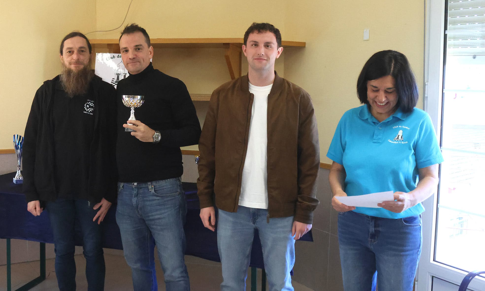

El 22 de noviembre de 2026 se disputó en la Casa de la Cultura de Cabanillas del Campo la tercera y última jornada del Campeonato Provincial por Equipos Guadalajara 2026, con las rondas 5 y 6. El club está representado por tres equipos: [Gambito de Guada A](https://info64.org/team/campeonato-provincial-por-equipos-guadalajara-2026/gambito-de-guada-a), [Gambito de Guada B](https://info64.org/team/campeonato-provincial-por-equipos-guadalajara-2026/gambito-de-guada-b) y [Gambito de Guada C](https://info64.org/team/campeonato-provincial-por-equipos-guadalajara-2026/gambito-de-guada-c).

## Resultados de la tercera jornada

### [Gambito de Guada C](https://info64.org/team/campeonato-provincial-por-equipos-guadalajara-2026/gambito-de-guada-c) — 3º clasificado

El equipo C cayó ante UNED A y empató después con UNED B. Termina tercero, con 7 puntos de match y 14,5 de tablero.

- Ronda 5: **UNED A 2,5 - 1,5 Gambito de Guada C**
- Ronda 6: **Gambito de Guada C 2 - 2 UNED B**

<figure>
  
  <figcaption>El Gambito de Guada C recoge la copa del tercer puesto</figcaption>
</figure>

### [Gambito de Guada A](https://info64.org/team/campeonato-provincial-por-equipos-guadalajara-2026/gambito-de-guada-a) — 4º clasificado

El equipo A perdió contra el Club Ajedrez Azuqueca y ganó el derbi al Gambito de Guada B. Queda cuarto, con 6 puntos de match y 13,5 de tablero.

- Ronda 5: **Gambito de Guada A 1 - 3 Club Ajedrez Azuqueca**
- Ronda 6: **Gambito de Guada B 1,5 - 2,5 Gambito de Guada A**

### [Gambito de Guada B](https://info64.org/team/campeonato-provincial-por-equipos-guadalajara-2026/gambito-de-guada-b) — 9º clasificado

El equipo B descansó en la ronda 5 y perdió el derbi contra el Gambito de Guada A. Termina noveno, con 5 puntos de match y 11,5 de tablero.

- Ronda 5: **descanso (2,5 puntos de tablero)**
- Ronda 6: **Gambito de Guada B 1,5 - 2,5 Gambito de Guada A**

## Rendimiento de los jugadores del Gambito de Guada

### [Gambito de Guada A](https://info64.org/team/campeonato-provincial-por-equipos-guadalajara-2026/gambito-de-guada-a)

- [Alberto Magán González](https://info64.org/team/campeonato-provincial-por-equipos-guadalajara-2026/gambito-de-guada-a/magan-gonzalez-alberto) — 3.5/5 pts
- [Javier Díaz Martín](https://info64.org/team/campeonato-provincial-por-equipos-guadalajara-2026/gambito-de-guada-a/diaz-martin-javier) — 2.5/5 pts
- [Miguel Ángel de Pablo Peña](https://info64.org/team/campeonato-provincial-por-equipos-guadalajara-2026/gambito-de-guada-a/de-pablo-pena-miguel-angel) — 1/4 pts
- [Jesús Alonso Palazón](https://info64.org/team/campeonato-provincial-por-equipos-guadalajara-2026/gambito-de-guada-a/alonso-palazon-jesus) — 3.5/5 pts
- [Ignacio Carballido Mateo](https://info64.org/team/campeonato-provincial-por-equipos-guadalajara-2026/gambito-de-guada-a/carballido-mateo-ignacio) — 3/5 pts

### [Gambito de Guada B](https://info64.org/team/campeonato-provincial-por-equipos-guadalajara-2026/gambito-de-guada-b)

- [Javier Gómez Vázquez](https://info64.org/team/campeonato-provincial-por-equipos-guadalajara-2026/gambito-de-guada-b/gomez-vazquez-javier) — 0/4 pts y 0,5 de descanso
- [Manuel Jesús Pérez Lorenzo](https://info64.org/team/campeonato-provincial-por-equipos-guadalajara-2026/gambito-de-guada-b/perez-lorenzo-manuel-jesus) — 0/3 pts y 0,5 de descanso
- [Roberto Corral Ruano](https://info64.org/team/campeonato-provincial-por-equipos-guadalajara-2026/gambito-de-guada-b/corral-ruano-roberto) — 4/5 pts y 0,5 de descanso
- [Iñaki Iglesias Ortiz](https://info64.org/team/campeonato-provincial-por-equipos-guadalajara-2026/gambito-de-guada-b/iglesias-ortiz-inaki) — 4/4 pts y 1 de descanso
- [Javier Gómez Resco](https://info64.org/team/campeonato-provincial-por-equipos-guadalajara-2026/gambito-de-guada-b/gomez-resco-javier) — 1/4 pts

### [Gambito de Guada C](https://info64.org/team/campeonato-provincial-por-equipos-guadalajara-2026/gambito-de-guada-c)

- [Efrén García Pardo](https://info64.org/team/campeonato-provincial-por-equipos-guadalajara-2026/gambito-de-guada-c/garcia-pardo-efren) — 1.5/6 pts
- [Sergio del Amo Caballero](https://info64.org/team/campeonato-provincial-por-equipos-guadalajara-2026/gambito-de-guada-c/del-amo-caballero-sergio) — 4/6 pts
- [Ismael Sierra Grasa](https://info64.org/team/campeonato-provincial-por-equipos-guadalajara-2026/gambito-de-guada-c/sierra-grasa-ismael) — 3/6 pts
- [Juan Carlos Aragonés Congostrina](https://info64.org/team/campeonato-provincial-por-equipos-guadalajara-2026/gambito-de-guada-c/aragones-congostrina-juan-car) — 2/2 pts
- [Mariano García Manzanares](https://info64.org/team/campeonato-provincial-por-equipos-guadalajara-2026/gambito-de-guada-c/garcia-manzanares-mariano) — 4/4 pts

## Premios individuales

[Roberto Corral Ruano](https://info64.org/team/campeonato-provincial-por-equipos-guadalajara-2026/gambito-de-guada-b/corral-ruano-roberto), del Gambito de Guada B, recibió el premio al mejor tablero 3. [Iñaki Iglesias Ortiz](https://info64.org/team/campeonato-provincial-por-equipos-guadalajara-2026/gambito-de-guada-b/iglesias-ortiz-inaki), también del equipo B, el premio al mejor tablero 4. [Mariano García Manzanares](https://info64.org/team/campeonato-provincial-por-equipos-guadalajara-2026/gambito-de-guada-c/garcia-manzanares-mariano), del Gambito de Guada C, el premio al mejor suplente.

## Clasificación final

| Pos. | Equipo | Puntos | Tablero |
|:---:|---|:---:|:---:|
| 1 | UNED A | 11 | 17 |
| 2 | Alfil Callejero A | 10 | 17 |
| 3 | **[Gambito de Guada C](https://info64.org/team/campeonato-provincial-por-equipos-guadalajara-2026/gambito-de-guada-c)** | 7 | 14,5 |
| 4 | **[Gambito de Guada A](https://info64.org/team/campeonato-provincial-por-equipos-guadalajara-2026/gambito-de-guada-a)** | 6 | 13,5 |
| 5 | Cabanillas 4 Torres A | 6 | 13,5 |
| 6 | Alfil Callejero B | 6 | 12 |
| 7 | UNED B | 6 | 11,5 |
| 8 | Club Ajedrez Azuqueca | 6 | 10,5 |
| 9 | **[Gambito de Guada B](https://info64.org/team/campeonato-provincial-por-equipos-guadalajara-2026/gambito-de-guada-b)** | 5 | 11,5 |
| 10 | UNED C | 5 | 9 |
| 11 | Cabanillas 4 Torres B | 2 | 2,5 |

[Clasificación general](https://info64.org/team/campeonato-provincial-por-equipos-guadalajara-2026/standings) · [Ronda 5](https://info64.org/team/campeonato-provincial-por-equipos-guadalajara-2026/5) · [Ronda 6](https://info64.org/team/campeonato-provincial-por-equipos-guadalajara-2026/6) · [Web oficial del torneo](https://www.ajedrezguadalajara.com/torneos/torneo-provincial-por-equipos-2026)
